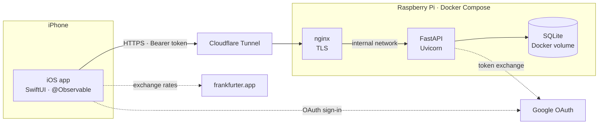

<div align="center">

# GoddoniTracker

**A native iOS expense tracker with a self-hosted Python backend.**

Log expenses in any currency, split shared costs, and see where your money goes with budget projections and category trends.

[](https://github.com/severingoddon/GoddoniTracker/actions/workflows/backend-tests.yml)


</div>

---

## About

GoddoniTracker is a personal finance app I built and use every day. It has a SwiftUI client with no third-party dependencies and a FastAPI backend that runs in Docker on a Raspberry Pi at home. The backend is reachable from anywhere through a Cloudflare Tunnel, without opening any ports on the router.

The UI is in German. Code, comments and docs are in English.

## Features

### Expenses
- **Quick entry** with title, amount, currency, category, date, payment method and comment
- **Monthly view** grouped by day, with daily, monthly and all-time totals and a month navigator
- **Search** across titles and comments
- **Swipe to delete**, tap to edit

### Shared costs
- **Split an expense** in half, by a percentage, or by entering your own share as an absolute amount
- The original amount is kept, so you can change the split later. Split expenses are marked in the list.

### Multi-currency
- Enter amounts in **any currency**. They are converted to CHF automatically using ECB rates from [frankfurter.app](https://frankfurter.app).
- The original amount and its CHF value are both stored, so historical totals don't change when exchange rates move.

### Analytics
- **Three time ranges:** current month, last 7 days and all time
- **Donut chart** of spending by category, with amounts and percentages. Tap a category to see all its expenses.
- **Budget tracking:** usage in percent, daily average, projected month-end total and the amount you can still spend per day
- **Spending chart:** your cumulative spending against the ideal budget line, with a forecast to the end of the month
- **Category comparison:** each category's spending this month compared with its average over the previous 3, 6 or 12 months (▲ more / ▼ less)

### Categories
- Custom categories with **emoji**, **drag-to-reorder** and rename
- A default set is created on first login. Categories that still have expenses can't be deleted.

### Data
- **CSV export** for any date range, shared via the iOS share sheet
- **CSV import** that creates missing categories automatically and accepts several date formats

## Architecture



### Engineering highlights

| Area | Approach |
|---|---|
| **iOS architecture** | MVVM with the Observation framework (`@Observable`), async/await networking and Swift Charts. No third-party packages. |
| **Authentication** | Google OAuth through `ASWebAuthenticationSession` and a custom URL scheme. The backend issues an opaque session token, which the app stores in the **Keychain**. A `401` signs the user out automatically. |
| **Access control** | Only Google accounts in an `ALLOWED_EMAILS` allowlist can sign in. Their email must be verified. If the list is empty, nobody can sign in. Every query is scoped to the authenticated user. |
| **Money handling** | Each expense stores the original amount and currency together with its CHF value at entry time. Splits keep the factor, so they can be reversed. |
| **Network exposure** | The backend container has no published port and is only reachable through nginx. The tunnel makes outbound connections only, so the router needs no inbound ports. |
| **Safe deployments** | The Ansible playbook backs up the database before every deploy. It refuses to run if the data volume is missing and checks the volume mount afterwards. It only touches this project's containers and images, because the Pi also runs other services. |
| **Testing** | The backend has a pytest suite that runs against an isolated in-memory database per test, with the Google OAuth round trip mocked. It covers auth and the allowlist, per-user data isolation, CRUD, analytics math and the CSV round trip. It runs on every push via GitHub Actions. |
| **Configuration** | Secrets and host details live in gitignored files (`backend/.env`, `ansible/inventory.ini`). The repo only contains `*.example` templates. |

## Tech stack

| Layer | Technology |
|---|---|
| **iOS** | Swift, SwiftUI, Swift Charts, Observation, Keychain Services, XcodeGen |
| **Backend** | Python 3.12, FastAPI, SQLAlchemy 2, Pydantic 2, Authlib |
| **Database** | SQLite on a persistent Docker volume |
| **Infrastructure** | Docker Compose, nginx, Cloudflare Tunnel, Raspberry Pi |
| **Deployment** | Ansible |

## Project structure

```
GoddoniTracker/
├── SwiftApp/
│   ├── project.yml              # XcodeGen project definition
│   └── GoddoniTracker/
│       ├── Auth/                # OAuth session and Keychain storage
│       ├── Network/             # API client, endpoints, errors
│       ├── Models/              # Codable API models
│       ├── ViewModels/          # @Observable view models
│       ├── Views/               # SwiftUI screens (list, form, analytics, settings)
│       ├── Theme/               # Colors and reusable styles
│       └── Extensions/
├── backend/
│   ├── main.py                  # FastAPI app and routes
│   ├── models.py                # SQLAlchemy models
│   ├── schemas.py               # Pydantic schemas
│   ├── database.py
│   └── tests/                   # pytest suite
├── .github/workflows/           # CI: backend tests
├── nginx/nginx.conf             # TLS reverse proxy
├── ansible/deploy.yml           # Deployment playbook
├── docker-compose.yml
└── docs/                        # API reference and deployment guide
```

## Getting started

### Backend

```bash
cd backend
python3 -m venv venv
source venv/bin/activate
pip install -r requirements.txt
cp .env.example .env            # then fill in your values
uvicorn main:app --reload --port 8001
```

You need a Google OAuth client ([Google Cloud Console](https://console.cloud.google.com/apis/credentials)) with `http://localhost:8001/api/auth/google/callback` as an authorized redirect URI. Add your Google account to `ALLOWED_EMAILS` in `.env`.

Run the tests:

```bash
pip install -r requirements-dev.txt
pytest
```

### iOS app

Requires Xcode 16+ and [XcodeGen](https://github.com/yonaskolb/XcodeGen).

```bash
brew install xcodegen
cd SwiftApp
xcodegen generate
open GoddoniTracker.xcodeproj
```

1. Set `baseURL` in `SwiftApp/GoddoniTracker/Network/APIEndpoints.swift` to your backend, e.g. `http://localhost:8001` for the simulator.
2. Select your development team under **Signing & Capabilities**. If you need to, change the bundle identifier in `project.yml`.
3. Build and run.

## Documentation

- [API reference](docs/API.md): all REST endpoints and the CSV format
- [Deployment guide](docs/DEPLOYMENT.md): Raspberry Pi, Docker Compose, Ansible, Cloudflare Tunnel, TLS

---

<div align="center">
Built by <a href="https://github.com/severingoddon">Severin Goddon</a>
</div>
